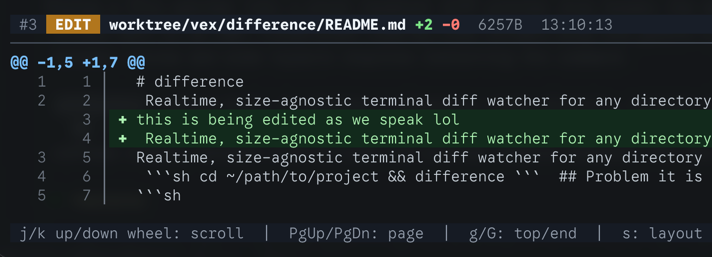

# difference

this is being edited as we speak lol



Realtime, size-agnostic terminal diff watcher for any directory — built natively in C23 on top of Vexgraph's `re` and `determinant`.

```sh
cd ~/path/to/project && difference
```

## Problem it is trying to solve (it is niche)

Standard diff workflows (`git diff`, `delta`, IDE diff panels) only show the cumulative change against `HEAD` inside a git repository. When you're iterating quickly in an editor, refactoring across multiple files, or working in a directory that isn't even tracked by git, you lose the chronological story of each individual save.

Piping a file watcher into a plain terminal diff printer also breaks the moment you resize your terminal window next to an IDE: fixed-width side-by-side columns wrap and garble scrollback, and switching between narrow and wide layouts requires restarting the command.

`difference` solves both: it watches a directory scope directly, records each save as its own `#1`, `#2`, `#3` delta with line and inline word/letter highlighting, and renders inside a fullscreen TUI that reflows cleanly between side-by-side and unified layouts whenever the terminal resizes.

## Features

- **Save-by-save live edit timeline**: Seeds initial text snapshots for the watched directory and diffs every subsequent save against the previous version, regardless of whether the directory is a git repo.
- **Line + inline word/letter diffing**: Computes grouped hunks with context lines and highlights the exact changed word or character spans on modified line pairs.
- **Per-edit metadata**: Displays edit sequence (`#1`, `#2`, ...), event pill (`NEW`, `EDIT`, `DEL`, `MOVE`), relative path, `+N -M` line counts, file byte size, and local `HH:MM:SS` timestamp.
- **Size-agnostic responsive TUI**: Built on `determinant`'s `TerminalCanvas`, `TerminalInput`, and `TerminalDiffPanel`. Automatically switches between **side-by-side** (`>= 100` cols) and **unified** (`< 100` cols) on `SIGWINCH`, flushing only changed rows inside synchronized frame brackets (`\x1b[?2026h` / `\x1b[?2026l`).
- **Interactive navigation**: Scroll with `j`/`k`, `↑`/`↓`, mouse wheel, `PgUp`/`PgDn`, `d`/`u`, or `g`/`G`; cycle `AUTO` / `SPLIT` / `UNIFIED` with `s`; toggle live tail `FOLLOW` / `PAUSED` with `f`; clear history with `c`; quit with `q` or `Ctrl-C`.
- **Stream fallback**: Pass `--stream` (or pipe stdout) to print diffs as a plain scrollable log instead of entering the alternate-screen TUI.
- **Noise filtering**: Skips binary files, dot-directories, build outputs (`cmake-build-*`, `build/`, `node_modules/`, `target/`, `dist/`, `__pycache__`), and editor safe-write temp files (`*.swp`, `*~`, `*___jb_tmp___`, `*___jb_old___`) by default.

## Dogfooding Across Vexgraph

`difference` is intentionally built directly on Vexgraph's own lower layers to stress-test them under real application workloads instead of relying only on isolated unit tests:

- **`re` (`io/file`, `nio/arena`)**:
  - Exposed and fixed a pre-existing `CFStringRef` bug in `FileEventWatcher_start`.
  - Drove the addition of `FileWatchProps` (latency, debounce, recursion, directory/hidden/pattern/extension filters) and rich `FileWatchEvent` metadata (`relativePath`, `timestampNs`, `epochSeconds`, `fileSize`), with `Memory_alloc` confined strictly to `FileEventWatcher_init`.
  - Stress-tested `MemoryArena` against a ~477 MiB workspace, highlighting how non-reclaiming bump blocks (`> 4 KiB`) require separating resettable scratch arenas from auto-compacting persistent arenas.
- **`determinant` (`ui/panel`, `ui/surface`, `events`)**:
  - Added a reusable, zero-alloc `TerminalDiffPanel` widget supporting both `FILE *` streaming and `TerminalCanvas` TUI painting so other Vexgraph TUIs (such as `semicolon`) can drop in responsive diff views directly.
  - Surfaced pre-existing compilation issues when linking `determinant` from a downstream app: static-inline getter collisions with public declarations in `terminal_surface.c` and const-qualifier warnings in `terminal_input.c`.
- **Workspace laws**: Built and verified at zero regressions against `./tools/lint` (`Relational Memory Law`, `String Law`, `Semantic Consistency Law`, `Living Documentation Law`, and `alloc_gate`).

## Future

- **Route rendering through `TerminalSurface` + `TerminalCompositor`**: Once `determinant/ui/surface/terminal_surface.c` is fixed so downstream apps can link it cleanly, drop `difference_tui.c`'s temporary ANSI delta flusher and present directly through `TerminalSurface` and `TerminalCompositor`.
- **Reusable compacting/growable arena helper in `re`**: Lift the scratch-arena + persistent-compaction pattern developed in `SnapshotStore` into `re` so other apps handling variable-sized buffers don't have to hand-roll it.
- **Cross-platform file watching**: Add Linux (`inotify`) and Windows (`ReadDirectoryChangesW`) backends to `re`'s `FileEventWatcher`.
- **Richer TUI navigation**: Jump between edits (`n`/`p`), filter by path or extension inside the TUI, and inspect an edit's full file context on demand.
- **Native `b` build target**: Link macOS framework flags cleanly through `tools/b` so `b build` / `b run` replaces the `tools/difference` wrapper script.

## Scope and Limitations

- **macOS only (for now)**: Live watching depends on `re`'s `FileEventWatcher`, which currently implements macOS FSEvents only.
- **Disk-save driven**: Only changes flushed to disk (e.g., `Cmd+S` or IDE auto-save) trigger diffs; unsaved in-memory editor buffers are not visible.
- **Text files up to 256 KiB**: Files larger than 256 KiB or containing NUL bytes in the first 4 KiB are skipped to keep snapshotting and LCS diffing fast and bounded.
- **In-memory history cap**: The TUI retains the most recent 64 edits in memory and does not persist history to disk after exit.
- **Not a VCS or merge tool**: `difference` does not read git commits, stage hunks, or apply patches — it is strictly a live observational diff viewer for a watched directory scope.
- **Temporary compositor bypass**: Until `determinant`'s `terminal_surface.c` compiles cleanly for external consumers, `DifferenceTui` uses `TerminalCanvas` and `TerminalInput` from `determinant` with its own synchronized-output ANSI presenter.
